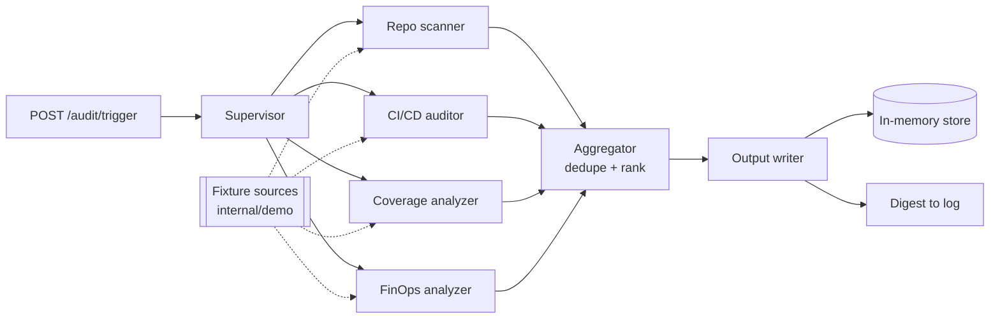

# build-agent-smith

A Go prototype of a **platform maturity audit agent**: it scans a manifest of repositories, scores CI/CD maturity, test coverage and cloud-waste signals, and ranks findings by cost × severity ÷ effort.

> **Status: working demo on fixture data.** Every data source is a deterministic in-process stub (`internal/demo`), and results are held in memory. Nothing here talks to GitHub, AWS, Codecov, Postgres or Slack yet. The numbers it prints come from fixtures, not from a real organization.

## What works today

- **Supervisor + worker pipeline** (Go, no framework): a supervisor plans scope and fans out to four workers, and an aggregator merges and ranks their findings.
    - `reposcanner`: checks for standardization artifacts (CI config, Dockerfile, branch protection signals).
    - `cicd`: parses pipeline YAML and scores it against a maturity rubric.
    - `coverage`: parses Codecov-style JSON coverage reports.
    - `finops`: flags underutilized or orphaned resources from an inventory.
- **Three audit scopes:** `full`, `incremental` (one repo), `finops_only`.
- **HTTP trigger:** `POST /audit/trigger` with `{"scope": "...", "repo": "..."}`.
- **Digest output:** a text summary is built and logged (stand-in for a Slack post).
- **Tests:** unit tests per package plus an end-to-end test; `make test` runs them with `-race`.



## Run it

```bash
make test          # unit + e2e tests with the race detector
make run           # builds bin/agent and serves on :8080
make smoke         # boots the server and exercises each scope with curl

# or by hand
curl -s -X POST localhost:8080/audit/trigger \
  -H 'Content-Type: application/json' \
  -d '{"scope":"full"}'
```

The repo list comes from `configs/repos.json` (a sample manifest of five fictional repos).

## Not built yet

- Real adapters for GitHub/GitLab, AWS Cost Explorer and CloudWatch, and Codecov. The worker interfaces are in place, so this means implementing `agent.Dependencies`.
- A PostgreSQL store. `migrations/001_schema.sql` holds the intended schema, but the running code uses `store.Memory`.
- A real Slack notifier, and Grafana dashboards over the stored results.
- An LLM planning step. Routing is deterministic today.

## Design notes

`TDD.md` is the original design document. It describes the target architecture, which is broader than what is implemented here.

## Background

The design comes from a platform-maturity audit I built for a real 28-repository organization. This repository is a clean-room rebuild on fixture data, and it carries no data or code from that environment.